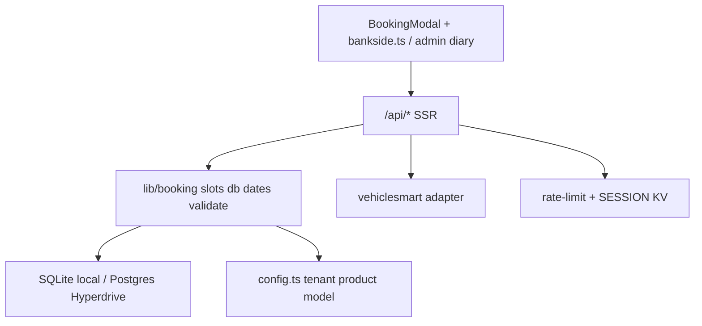
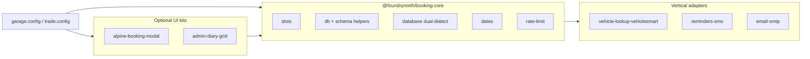

# Harvested IP — Bankside MOT stack

Product architecture assessment for Foundry North. Evaluates this repo as (A) a white-label **Garage-in-a-Box** template and (B) a source of standalone booking modules for other trade/service builds.

Grounded in the live Bankside MOT codebase and studio Cursor rules (`.cursor/rules/`, `AGENTS.md`). No runtime changes are implied by this document.

---

## 1. Extractable Modules & Coupling Score (1–5)

**Scale:** 1 = package-ready with thin adapters · 5 = Bankside-locked (brand, UK MOT product, or infra IDs baked in).



| Module | Score | Verdict |
|--------|------:|---------|
| Booking core (`slots.ts`, `db.ts`, `database.ts`, `validate.ts`) | **2** | Strongest extract. Diary/resource/capacity + unique active-slot index is already multi-bay capable. |
| `vehiclesmart.ts` (+ lookup rate-limit) | **3** | Clean adapter API; product is UK DVLA/MOT + Vehicle Smart vendor. |
| `BookingModal.astro` + `bankside.ts` | **4** | Reusable JSON contracts; UI/script namespaces and MOT defaults are brand-locked. |
| Workshop diary (`admin-diary.ts` + `admin/index.astro`) | **4** overall (`admin-diary.ts` alone **2**) | Autocomplete is portable; calendar page forces MOT-only. |

### Booking core — score 2

**What is generic today**

- Diaries expose `durationMinutes`, `slotTimes`, and `resources[]`; `getSlotsForDate` treats capacity as `diary.resources.length` (`src/lib/booking/slots.ts`).
- Concurrency is a partial unique index `idx_active_bay` on `(diary, resource, date, time)` for active statuses, with insert retry across candidate resources (`src/lib/booking/schema.sql`, `src/lib/booking/db.ts`).
- Dual dialect: local SQLite `data/bookings.db` vs Postgres via Hyperdrive / `DATABASE_URL` / `SUPABASE_DB_URL` (`src/lib/booking/database.ts`). Same SQL helpers (`ciEq`, `ciLike`, `stringAgg`) keep admin search portable.
- Hand-rolled validation returning `{ errors, value }` (`src/lib/booking/validate.ts`) — no Zod dependency to strip later.
- Supporting primitives already package-shaped: `dates.ts`, `rate-limit.ts`, `http.ts` (`jsonNoStore`), `ids.ts`, `money.ts`.

**What still couples to Bankside**

- Default diary id `'mot'` in `slots.ts`, `parseDiaryId`, schema defaults, and many call sites.
- Hardcoded garage phone `01324 613007` in validation / API error copy (not always read from `business` in `site.ts`).
- Locale helpers assume `Europe/London`, `en-GB`, GBP.

**Reuse path:** extract as `@foundrynorth/booking-core`; inject tenant config for diaries/services/locale; keep schema defaults configurable.

### Vehicle Smart VRM lookup — score 3

**Extractable**

- `lookupVehicleByVrm`, `VehicleLookup` / `MotTone` types, in-memory hour cache, env key resolution (`VEHICLESMART_API_KEY` / `VEHICLE_SMART_API_KEY`) in `src/lib/booking/vehiclesmart.ts`.
- Public route `GET /api/lookup-vrm` already rate-limits via the shared bucket API.

**Coupled**

- Response mapping is MOT-status UX (`ok` / `due` / `expired`) for UK plates.
- Vendor URL and field names are Vehicle Smart–specific; swapping DVLA providers means a new adapter behind the same `VehicleLookup` shape.
- Weak fit for non-automotive verticals (no VRM concept).

**Reuse path:** ship as `@foundrynorth/vehicle-lookup-vehiclesmart` implementing a tiny `VehicleLookupProvider` interface; omit from non-auto Garage-in-a-Box feature flags.

### Public booking flow — score 4

**Extractable**

- Step machine talks to stable contracts: `GET /api/lookup-vrm`, `GET /api/slots`, `POST /api/bookings` (plus contact).
- Alpine pattern (`x-data` app + modal steps) is copyable without React islands.

**Coupled**

- Script/app names and consent/analytics globals: `banksideApp`, `bankside_cookie_consent`, `__BANKSIDE_ANALYTICS`, `bankside_*` events (`src/scripts/bankside.ts`, `Layout.astro`).
- UI assumes UK yellow plate (`.uk-plate`), MOT-first services, Payment Assist, and hardcoded phone/address confirmation copy in `BookingModal.astro`.
- Default conversion value / Class 4 MOT price assumptions in client tracking.

**Reuse path:** white-label the Alpine kit to read `garage.config` (brand strings, services, phone); rename namespaces; keep API contracts unchanged.

### Workshop diary surface — score 4 (autocomplete 2)

**`admin-diary.ts` (score 2)** — directory autocomplete against `GET /api/admin/directory`. Field-name driven, almost no Bankside strings. Ready to drop into other admin forms.

**`admin/index.astro` (drives overall 4)** — product gate, not an engine gap:

```ts
const diaryId = 'mot' as const;
// GET ?diary=service → redirect away
const postedDiary = 'mot' as const;
```

Copy still says the MOT diary only; servicing is “on the workshop’s own system.” Multi-resource service diary already exists in `config.ts` but never reaches this UI.

**Reuse path:** finish diary switcher (see §3), then extract week-grid + form POST patterns as an optional admin UI kit on top of booking-core.

---

## 2. The "4-Hour Garage Clone" Blueprint

Opportunity **A** framing: **config-led white-label**, one Worker deploy per garage — not multi-tenant SaaS in v1.

### Hardcoded Bankside / Falkirk assumptions (beyond `site.ts` and `global.css`)

#### Infra & package identity

| File | What is locked |
|------|----------------|
| `wrangler.jsonc` | Worker `name: "banksidemot"`; KV `SESSION` id `f1a7d6b7646e476c97d64d607ac1e09c`; Hyperdrive id `88bf378e0d284bdfadba7b5b9ba4a981` |
| `astro.config.mjs` | `site: 'https://banksidemot.com'` |
| `package.json` | `"name": "bankside-mot-website"` |
| `public/robots.txt` | Sitemap host `banksidemot.com` |
| `.env.example` | Default SMTP/from addresses and staff password keys named for Stephen/Alison/Colin/Mack |

#### Product model (bays, hours grid, pricing)

| File | What is locked |
|------|----------------|
| `src/lib/booking/config.ts` | `TIMEZONE = 'Europe/London'`; MOT diary 1× bay, 45‑min slots 08:30–16:00; service diary 2 mechanics × 120‑min; prices £50 / £175 / £260 / £45 / £310; `PAYMENT_METHODS` includes `0% Payment Assist`; `garageEmail()` fallback `hello@banksidemot.com` |
| `src/lib/booking/schema.sql` | Defaults `diary = 'mot'`, `resource = 'bay'`, `payment_method = 'Pay at Garage'` |
| `src/lib/booking/slots.ts` / `db.ts` / `dates.ts` | MOT-first defaults; weekday-only open logic; `en-GB` formatting |
| `src/lib/booking/money.ts` | GBP / `en-GB` |

#### People & auth namespaces

| File | What is locked |
|------|----------------|
| `src/lib/booking/database.ts` | Staff seed Stephen / Alison / Colin / Mack + `STAFF_*_PASSWORD` |
| `scripts/reset-workshop.ts` | Same staff roster wipe/reseed |
| `src/data/team.ts` | Marketing bios (Bankside/Falkirk/MOT) |
| `src/lib/booking/auth.ts` | Cookie `bankside_admin`; local password default `bankside-local` |

#### Comms

| File | What is locked |
|------|----------------|
| `src/lib/booking/email-templates.ts` | Customer subject `… {{garage_name}} Falkirk ({{booking_id}})` |
| `src/lib/booking/email.ts`, `src/pages/api/contact.ts`, `src/pages/api/slots.ts`, `src/lib/booking/validate.ts` | Phone `01324 613007` in user-facing errors |

#### Public UI / SEO / geo

| File | What is locked |
|------|----------------|
| `src/pages/mot-falkirk.astro` | Entire Falkirk MOT pillar page + Offer JSON-LD |
| `src/pages/sitemap.xml.ts` | Prioritises `/mot-falkirk` |
| `src/data/areas.ts`, `faqs.ts`, `reviews.ts`, `photos.ts` | Towns, FK postcodes, MOT FAQ answers, photo briefs |
| `src/components/Header.astro`, `Footer.astro`, `BookingModal.astro`, `Logo.astro`, `ReviewSlot.astro` | FK2 badge, Payment Assist nav, plate placeholder, logo alts, Falkirk defaults |
| `src/layouts/Layout.astro` | `lang="en-GB"`, `geo.placename=Falkirk`, `x-data="banksideApp"`, theme colour |
| Marketing pages (`index`, `about`, `book`, `services`, `areas`, `contact`, `finance`, `discs-and-pads`, legal, `404`) | Duplicated prices, phone `tel:01324613007`, Falkirk copy |
| Admin chrome titles | `… \| Bankside MOT & Repair` across diary/customers/vehicles/staff/emails |

#### Client script / analytics namespaces

| File | What is locked |
|------|----------------|
| `src/scripts/bankside.ts` | App id, consent cookie, GA event prefixes, MOT defaults |
| `src/components/Analytics.astro`, `src/env.d.ts` | `__BANKSIDE_ANALYTICS` |

#### Assets

| Path | What is locked |
|------|----------------|
| `public/images/logo*.png`, `og-image.*`, favicons | Bankside marks and “Class 4 MOT from £50 / Falkirk” OG art |
| `public/images/*` workshop/hero set | This garage’s photography |

**Clone friction note:** even with a perfect `garage.config.ts`, many Astro pages still hardcode prices and phone. Hitting a true sub‑4‑hour clone requires either (1) pages that only read config/data modules, or (2) a disciplined search-replace + asset swap checklist on day one of the productised template.

### Target `garage.config.ts` (illustrative)

Central tenant file the template should grow toward. Bankside values shown as the reference tenant.

```ts
// garage.config.ts — single source of truth for a Garage-in-a-Box deploy
export default {
  id: 'bankside',

  brand: {
    name: 'Bankside MOT & Repair',
    shortName: 'Bankside MOT & Repair',
    legalName: 'Bankside MOT & Repair',
    domain: 'https://banksidemot.com',
    themeColor: '#115d50',
    logo: '/images/logo.png',
    logoMark: '/images/logo-mark.png',
    ogImage: '/og-image.png',
  },

  contact: {
    telephoneDisplay: '01324 613007',
    telephone: '+441324613007',
    email: 'hello@banksidemot.com',
    streetAddress: 'Unit 1b, Castlelaurie Industrial Estate',
    addressLocality: 'Falkirk',
    addressRegion: 'Stirlingshire',
    postalCode: 'FK2 7XJ',
    addressCountry: 'GB',
    latitude: 56.01225,
    longitude: -3.778919,
    mapsEmbed: 'https://maps.google.com/maps?q=…&output=embed',
    mapsUrl: 'https://maps.google.com/?cid=1414482120106289820',
  },

  locale: {
    timezone: 'Europe/London',
    currency: 'GBP',
    lang: 'en-GB',
    geoRegion: 'GB-SCT',
  },

  hours: {
    weekdays: { opens: '08:30', closes: '17:00' },
    saturdayDisplay: 'By appointment',
    sundayDisplay: 'Closed',
    bookingHorizonDays: 56,
    sameDayBufferMinutes: 30,
    weekdaysOnly: true,
  },

  diaries: {
    mot: {
      id: 'mot',
      name: 'MOT',
      blurb: '45-minute tests from 08:30, last slot 16:00',
      durationMinutes: 45,
      slotTimes: ['08:30', '09:15', '10:00', '10:45', '11:30', '12:15', '13:00', '13:45', '14:30', '15:15', '16:00'],
      resources: [{ id: 'bay', label: 'MOT bay' }],
    },
    service: {
      id: 'service',
      name: 'Services',
      blurb: 'Two-hour slots across two mechanics',
      durationMinutes: 120,
      slotTimes: ['08:30', '10:30', '12:30', '14:30'],
      resources: [
        { id: 'mech-1', label: 'Mechanic 1' },
        { id: 'mech-2', label: 'Mechanic 2' },
      ],
    },
  },

  services: [
    { id: 'class-4-mot', name: 'Class 4 MOT', price: 50, diary: 'mot', public: true, from: false, bookOnline: true, slotKind: 'hourly' },
    { id: 'class-7-mot', name: 'Class 7 MOT', price: 50, diary: 'mot', public: false, from: false, bookOnline: false, slotKind: 'hourly' },
    { id: 'interim-service', name: 'Interim Service', price: 175, diary: 'service', public: true, from: true, bookOnline: false, slotKind: 'hourly' },
    { id: 'major-service', name: 'Major Service', price: 260, diary: 'service', public: true, from: true, bookOnline: false, slotKind: 'hourly' },
    { id: 'diagnostic-scan', name: 'Diagnostic Scan', price: 45, diary: 'service', public: true, from: true, bookOnline: false, slotKind: 'hourly' },
    { id: 'mot-major-combo', name: 'MOT + Major Service Combo', price: 310, diary: 'mot', public: true, from: true, bookOnline: true, slotKind: 'morning-dropoff' },
  ],

  paymentMethods: ['Pay at Garage', '0% Payment Assist'],

  staffSeed: [
    { key: 'STAFF_STEPHEN_PASSWORD', username: 'stephen', name: 'Stephen' },
    { key: 'STAFF_ALISON_PASSWORD', username: 'alison', name: 'Alison' },
    { key: 'STAFF_COLIN_PASSWORD', username: 'colin', name: 'Colin' },
    { key: 'STAFF_MACK_PASSWORD', username: 'mack', name: 'Mack' },
  ],

  seo: {
    defaultTitle: 'MOT Test Falkirk | Class 4 MOT £50, Servicing | Bankside MOT & Repair',
    defaultDescription: 'DVSA-approved Class 4 MOT tests in Falkirk for £50…',
    areaServed: ['Falkirk', 'Grangemouth', 'Larbert', 'Polmont', 'Stenhousemuir', 'Denny'],
    pillarRoutes: [{ path: '/mot-falkirk', priority: 0.95 }],
  },

  infra: {
    workerName: 'banksidemot',
    // Provision NEW Hyperdrive + KV per garage — never reuse Bankside IDs
    // hyperdriveId / sessionKvId filled by deploy checklist
  },

  features: {
    vehicleLookup: 'vehiclesmart', // or 'none'
    financePage: true,
    serviceDiaryAdmin: false, // flip true when Pro tier ships (§3)
    motReminders: false,
  },

  namespaces: {
    alpineApp: 'garageApp',
    adminCookie: 'garage_admin',
    consentCookie: 'garage_cookie_consent',
    analyticsGlobal: '__GARAGE_ANALYTICS',
  },
} as const;
```

### 4-hour clone checklist (operator path)

1. Copy template repo; set `garage.config.ts` (brand, contact, diaries, services, prices, staff keys, SEO).
2. Swap logos, OG, favicon, hero/workshop images under `public/`.
3. Provision Cloudflare: new Worker name, **new** Hyperdrive (Supabase pooler) + **new** SESSION KV; write IDs into `wrangler.jsonc` (or generate from config).
4. Set secrets: `SESSION_SECRET`, `ADMIN_*`, `STAFF_*`, `DATABASE_URL` (if not Hyperdrive-only), `VEHICLESMART_API_KEY`, SMTP, optional `PUBLIC_GA_*` / Ads labels.
5. Replace area/FAQ/team/review content modules; point `astro.config` `site` at the new domain.
6. Smoke: `npm run build`, preview booking + admin login, confirm emails, confirm slot uniqueness under double-submit.
7. DNS + Workers deploy (`npx wrangler deploy`). Leave `netlify.toml.legacy` unused.

Do **not** reuse Bankside Hyperdrive/KV IDs. Do **not** run `scripts/reset-workshop.ts` against a live client database.

---

## 3. Completing the "Pro Tier" Upsell (Service Diary & Reminders)

Goal: turn a basic MOT booking brochure into a **high-ticket recurring retainer** — workshop ops diary + automated MOT expiry chase.

### Service diary — engine ready, UI gated

**Already built**

- `DIARIES.service` with two mechanic resources and 120‑minute slots (`config.ts`).
- Slot capacity and booking insert already respect multiple resources (`slots.ts`, `db.ts`).
- `parseDiaryId`, `servicesForDiary`, and schema `diary` column support `'service'`.

**Minimum work to ship**

1. **Un-gate admin calendar** in `src/pages/admin/index.astro`: remove `diaryId = 'mot' as const`, stop redirecting `?diary=service`, honor `parseDiaryId` on GET/POST (`postedDiary`).
2. **Diary switcher** in `AdminLayout` / diary header (MOT | Services) preserving `week` / `id` query params.
3. **Multi-resource week grid** — render one column/row set per `diary.resources` (service has `mech-1` / `mech-2`); compose forms already pass `resource`.
4. **Service catalogue policy** — decide which `bookOnline` flags flip for interim/major/diagnostic (today all service lines are phone-only); keep MOT public booking explicit.
5. **Copy / empty states** — delete “servicing is booked on the workshop’s own system”; add mechanic labels from config.
6. **QA** — cross-diary isolation (MOT bay booking must not block mechanic slots), morning-dropoff combo still on MOT diary, emails show correct diary/resource.

No schema migration required for the diary itself.

### MOT expiry reminders — new product surface

**Gap today**

- MOT expiry exists only on Vehicle Smart lookup payloads (`motExpiry` / `motTone` in `vehiclesmart.ts`).
- `vehicles` table stores `vrm`, `make_model`, `engine`, `notes` — **no** `mot_expiry`, **no** reminder timestamps (`schema.sql`).
- Email templates are booking/callback only; no SMS provider; no cron/trigger Worker.

**Minimum work (email first, SMS as Pro add-on)**

1. **Schema:** add `vehicles.mot_expiry`, `vehicles.mot_status`, `vehicles.last_reminded_at`, optional `customers.reminders_opt_in`.
2. **Backfill:** on successful `/api/lookup-vrm` and booking create, persist expiry onto the vehicle row.
3. **Scheduler:** Cloudflare Worker cron (e.g. daily) selecting vehicles with expiry inside windows (30 / 14 / 7 days), not yet reminded for that window.
4. **Channels:** new email template ids (`mot_reminder_customer`, `mot_reminder_garage`) via existing nodemailer path; SMS behind env (`TWILIO_*` or equivalent) only when opted in.
5. **Safety:** rate-limit sends; admin preview + kill switch; never SMS without consent; log send outcomes.
6. **Admin:** simple “Reminders” screen — upcoming expiries, last sent, manual resend.

**Retainer narrative:** Base = marketing site + MOT online booking. Pro = dual diary ops + expiry automation that feeds the bay every month without paid ads.

---

## 4. Cross-Industry Spin-Offs

Opportunity **B**: harvest booking-core for multi-resource local businesses without rewriting concurrency or the SQLite/Postgres deploy story.

### Abstraction map

| Garage concept | Generic name | Example mappings |
|----------------|--------------|------------------|
| `diary` | Calendar / service line | Detailing vs PPF; injectables vs facials; grooming vs boarding |
| `resource` | Bookable unit | Bay, chair, room, groomer, van/engineer |
| `idx_active_bay` | Active slot uniqueness | Keep `(calendar, resource, date, time)` WHERE status active |
| Dual dialect | Local SQLite / hosted Postgres+Hyperdrive | Same `AGENTS.md` cold-start story |
| `vrm` | External reference | Pet name, unit ID, job site postcode — optional string |
| Vehicle Smart | Vertical adapter | Swap for no-op or industry lookup |
| Alpine modal / admin diary | Optional UI kits | Restyle; keep JSON + form POST contracts |

### What not to rewrite

- Slot generation from config grids + capacity = `resources.length`.
- Insert-with-retry across free resources on unique violation.
- Rate-limit buckets (KV on Workers, local fallback).
- Middleware cookie session pattern for admin (rename cookie via config).

### Suggested package split



**First spin-off targets** (same engine, new config): detailing studios (multi-bay), aesthetics clinics (rooms/practitioners), dog groomers (tables/groomers), trade callouts (engineer vans as resources with travel buffers later).

**Do not** force VRM or MOT tone into those verticals — gate `features.vehicleLookup` and treat reference fields as plain text.

---

## Recommendations (A vs B)

| Opportunity | Play | Priority harvest |
|-------------|------|------------------|
| **A — Garage-in-a-Box** | Config-led white-label + asset/bindings checklist; collapse page-level hardcoding into `garage.config.ts` + `src/data/*` | Tenant config, wrangler-per-garage, content modules |
| **B — Module spin-offs** | Publish booking-core first; Vehicle Smart and Alpine/admin kits as optional add-ons | `slots` / `db` / `database` / `dates` / `rate-limit` |

Sequence for Foundry North: finish Pro diary unlock on Bankside (reference customer) → freeze booking-core API → productise Garage-in-a-Box clone checklist → offer core+kits to non-auto trades.
